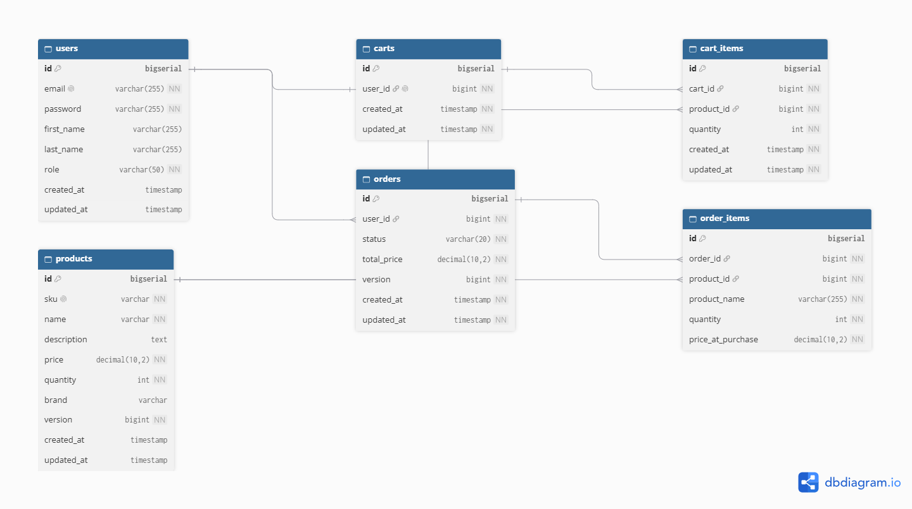

# spring-commerce

[](#)
[](#)
[](#)
[](#)
[](#)
[](#)

An e-commerce REST API built with **Java 21** and **Spring Boot 3**.

Designed as a **package-by-feature modular monolith**, each domain module encapsulates its own presentation, business logic, persistence, and DTO layers while enforcing **Dependency Inversion** through strict interface boundaries.

## Key Features

- **Product Catalog & Inventory:** Full CRUD operations, multi-criteria filtering (by brand and price range), dynamic price sorting, and **optimistic locking** to prevent lost updates under concurrent writes.
- **Shopping Cart:** Lazy cart creation, stock availability checks, automatic quantity merging, and live total calculation without storing prices in the cart table.
- **Order Management:** Atomic checkout in a single transaction (stock reservation, price and product name snapshots, cart clearing), an order status state machine with validated transitions, and automatic stock restoration on cancellation.
- **Authentication & Role-Based Security:** Stateless **JWT** authentication with **Spring Security**, **BCrypt** password hashing, role-based access control (`ADMIN` / `CUSTOMER`), and ownership checks (`CurrentUser`) to prevent IDOR across cart and order endpoints.
- **Centralized Exception Handling:** Unified error interception across domain, security, and validation layers returning a consistent JSON response envelope (`GenericResponse` / `ErrorResponse`).
- **Externalized Bean Validation:** Request payload validation backed by centralized message bundles in `validations.properties`.
- **Database Schema Versioning:** Repeatable, version-controlled database migrations managed via **Liquibase**, with Hibernate set to `validate` only.
- **Pluggable Persistence Strategy:** Abstracted data access supporting both JPA/PostgreSQL and an in-memory store for fast, isolated testing.
- **Multi-Environment Profiles:** Tailored configurations for `dev`, `local`, `test`, and `prod` environments.

## Tech Stack

- **Language:** Java 21
- **Framework:** Spring Boot 3, Spring Security (JWT), Spring Web
- **Persistence:** Spring Data JPA, Hibernate, PostgreSQL
- **Database Migrations:** Liquibase
- **Validation:** Jakarta Bean Validation
- **Build & Containerization:** Maven, Docker Compose

## Architecture

The codebase follows a **package-by-feature** structure rather than traditional horizontal layering, keeping domain logic cohesive and decoupled. Each feature package contains its own `controller`, `service`, `repository`, and `dtos`.

```text
src/main/java/com/abdalrahman/springcommerce/
├── auth/
│   ├── controller/
│   ├── service/
│   └── dtos/
├── cart/
│   ├── controller/
│   ├── service/
│   ├── repository/
│   ├── dtos/
│   ├── Cart.java
│   └── CartItem.java
├── order/
│   ├── controller/
│   ├── service/
│   ├── repository/
│   ├── dtos/
│   ├── Order.java
│   ├── OrderItem.java
│   └── OrderStatus.java
├── product/
│   ├── controller/
│   ├── service/
│   ├── repository/
│   ├── dtos/
│   └── Product.java
├── user/
│   ├── controller/
│   ├── service/
│   ├── repository/
│   ├── dtos/
│   ├── User.java
│   └── Role.java
├── security/
│   ├── CurrentUser.java
│   ├── JwtAuthenticationFilter.java
│   ├── JwtService.java
│   ├── RestSecurityErrorHandler.java
│   └── SecurityConfig.java
└── shared/
    ├── errors/
    └── utils/
```

## Design Decisions

- **Cart is mutable, Order is immutable.** The cart shows live prices computed from the catalog. An order stores `price_at_purchase` and `product_name` per item, so order history never changes when the catalog does.
- **Atomic checkout.** `placeOrder` runs in one transaction. If any item is out of stock, the whole operation rolls back and the cart and stock are left untouched.
- **Overselling protection.** Stock changes go through `ProductService` and are guarded by `@Version` optimistic locking.
- **Order state machine.** Allowed transitions: `PENDING` to `CONFIRMED` to `SHIPPED` to `DELIVERED`. Cancellation is allowed only from `PENDING` or `CONFIRMED`, and it restores stock.
- **Stateless JWT & IDOR prevention.** Cart and order endpoints resolve the authenticated user directly from the JWT via `CurrentUser` instead of accepting `userId` in the URL, and order lookups enforce owner-or-admin checks.
- **Module boundaries.** Modules talk to each other through service interfaces, never through another module's repository. Cart and Order reference users and products by id, not by entity.
- **Database as the last line of defense.** Invariants such as one cart per user, one row per product per cart, and positive quantities are enforced with constraints, not only in code.

## Database Schema



## Getting Started

### Prerequisites

- **JDK 21** or higher
- **Docker** and **Docker Compose**

### Run Locally

1. **Clone the repository:**
   ```bash
   git clone https://github.com/abdalrahmanehab/spring-commerce.git
   cd spring-commerce
   ```

2. **Start the PostgreSQL container:**
   ```bash
   docker compose up -d
   ```
   > **Note:** The PostgreSQL container is mapped to host port `5433` to prevent port collisions with any existing local PostgreSQL instance.

3. **Build and run the application:**
   ```bash
   ./mvnw spring-boot:run -Dspring-boot.run.profiles=local
   ```

The API will be available at the base URL: `http://localhost:8080/commerce`

## API Testing

This repository includes a ready-to-use Postman collection.
1. Import `postman/spring-commerce.postman_collection.json` into Postman.
2. Select the built-in `spring-commerce API` environment.
3. Register or log in via `/api/v1/auth/login` and pass the returned JWT as a `Bearer` token in the `Authorization` header for protected endpoints.

## API Endpoints

### Auth Module

| Method | Endpoint | Access | Description |
| :--- | :--- | :--- | :--- |
| `POST` | `/api/v1/auth/register` | Public | Register a new user account |
| `POST` | `/api/v1/auth/login` | Public | Authenticate and receive a JWT token |

### User Module

| Method | Endpoint | Access | Description |
| :--- | :--- | :--- | :--- |
| `GET` | `/api/v1/users/me` | Authenticated | Retrieve the current authenticated user's profile |
| `GET` | `/api/v1/users` | Admin | Retrieve all users |
| `GET` | `/api/v1/users/{id}` | Admin | Retrieve a user by ID |
| `DELETE` | `/api/v1/users/{id}` | Admin | Delete a user by ID |

### Product Module

| Method | Endpoint | Access | Description |
| :--- | :--- | :--- | :--- |
| `POST` | `/api/v1/products` | Admin | Create a new product |
| `GET` | `/api/v1/products` | Public | Retrieve all products |
| `GET` | `/api/v1/products/id/{id}` | Public | Retrieve a product by ID |
| `GET` | `/api/v1/products/sku/{sku}` | Public | Retrieve a product by SKU |
| `GET` | `/api/v1/products/brand/{brand}` | Public | Filter products by brand |
| `GET` | `/api/v1/products/price-range?min={min}&max={max}` | Public | Filter products within a price range |
| `GET` | `/api/v1/products/sorted?direction={ASC\|DESC}` | Public | Sort products by price (`ASC` or `DESC`) |
| `PUT` | `/api/v1/products/{id}` | Admin | Update an existing product |
| `DELETE` | `/api/v1/products/{id}` | Admin | Delete a product by ID |

### Cart Module

| Method | Endpoint | Access | Description |
| :--- | :--- | :--- | :--- |
| `GET` | `/api/v1/carts` | Authenticated | Retrieve the current user's cart |
| `POST` | `/api/v1/carts/items` | Authenticated | Add an item to the cart |
| `PUT` | `/api/v1/carts/items/{productId}` | Authenticated | Update item quantity in the cart |
| `DELETE` | `/api/v1/carts/items/{productId}` | Authenticated | Remove an item from the cart |
| `DELETE` | `/api/v1/carts` | Authenticated | Clear all items from the cart |

### Order Module

| Method | Endpoint | Access | Description |
| :--- | :--- | :--- | :--- |
| `POST` | `/api/v1/orders` | Authenticated | Place an order from the current user's cart |
| `GET` | `/api/v1/orders/{orderId}` | Owner / Admin | Retrieve an order by ID |
| `GET` | `/api/v1/orders` | Authenticated | Retrieve the current user's order history |
| `PATCH` | `/api/v1/orders/{orderId}/status` | Admin | Update order status |

## Profiles

Activate a specific profile via `-Dspring-boot.run.profiles=<profile>` or `SPRING_PROFILES_ACTIVE`:

- **`dev`** - Default development profile.
- **`local`** - Local development connected to the Dockerized PostgreSQL instance (`localhost:5433`).
- **`test`** - Fast, isolated testing environment backed by the in-memory store (`InMemoryDb`).
- **`prod`** - Production-ready configuration.

## Roadmap

- [x] Product, User, Cart, and Order modules
- [x] JWT authentication and role-based authorization
- [ ] Security integration tests (role enforcement and IDOR checks)
- [ ] Product pagination and OpenAPI documentation
- [ ] Integration tests with Testcontainers and a concurrency test for overselling
- [ ] CI pipeline with GitHub Actions
- [ ] Semantic product search with Spring AI