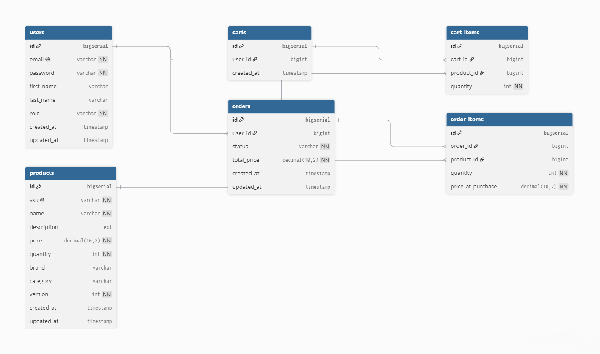

# spring-commerce

An e-commerce REST API built with Java 21 and Spring Boot.

Package-by-feature modular monolith. Each feature owns its controller, service, repository, and DTOs. Dependency Inversion via interfaces.

## Architecture

    src/main/java/com/abdalrahman/springcommerce/
    ├── product/
    │   ├── Product.java
    │   ├── controller/
    │   │   └── ProductController.java
    │   ├── dtos/
    │   │   ├── ProductRequest.java
    │   │   └── ProductResponse.java
    │   ├── repository/
    │   │   ├── DbService.java
    │   │   ├── InMemoryDb.java
    │   │   ├── JpaDb.java
    │   │   ├── ProductRepository.java
    │   │   ├── ProductRepositoryImpl.java
    │   │   └── SpringDataProductRepository.java
    │   └── service/
    │       ├── ProductService.java
    │       └── ProductServiceImpl.java
    └── shared/
        ├── errors/
        │   ├── exceptions/
        │   │   ├── DuplicateSkuException.java
        │   │   └── ResourceNotFoundException.java
        │   ├── handlers/
        │   │   ├── GlobalExceptionHandler.java
        │   │   ├── ProductExceptionHandler.java
        │   │   └── ValidationExceptionHandler.java
        │   └── models/
        │       ├── ErrorResponse.java
        │       └── GenericResponse.java
        └── utils/
            ├── enums/
            │   └── SortDirection.java
            ├── mapper/
            │   └── ProductMapper.java
            └── time/
                └── TimeHelper.java

## Database Schema

## Tech Stack

- Language: Java 21
- Framework: Spring Boot 3
- Persistence: Spring Data JPA + PostgreSQL
- Migrations: Liquibase
- Validation: Bean Validation
- Build: Maven

## Features

- Product module: CRUD, filtering by brand and price range, sorting
- Centralized exception handling with consistent error envelope
- Bean Validation with messages in `validations.properties`
- Database schema versioning with Liquibase
- Profile-based configuration (dev, local, test, prod)

## Getting Started

    git clone https://github.com/abdalrahmanehab/spring-commerce.git
    cd spring-commerce
    docker compose up -d
    ./mvnw spring-boot:run

Base URL: `http://localhost:8080/commerce`

The PostgreSQL container starts on port `5433` to avoid conflicts with a local PostgreSQL install.

## API Endpoints

### Product Module

| Method | Endpoint | Description |
|---|---|---|
| POST | /api/v1/products | Create a product |
| GET | /api/v1/products | Get all products |
| GET | /api/v1/products/id/{id} | Get product by ID |
| GET | /api/v1/products/sku/{sku} | Get product by SKU |
| GET | /api/v1/products/brand/{brand} | Filter products by brand |
| GET | /api/v1/products/price-range?min=&max= | Filter products by price range |
| GET | /api/v1/products/sorted?direction= | Sort products by price (ASC/DESC) |
| PUT | /api/v1/products/{id} | Update a product |
| DELETE | /api/v1/products/{id} | Delete a product |
| DELETE | /api/v1/products | Delete all products |

## Profiles

- `dev` — default development profile
- `local` — local development with PostgreSQL
- `test` — in-memory store for tests
- `prod` — production 