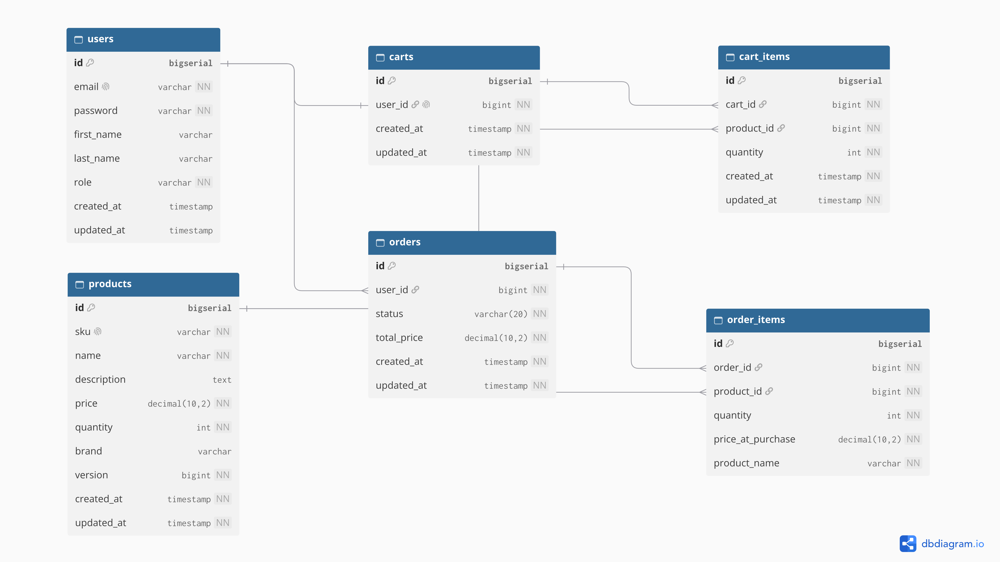

# spring-commerce

[](#)
[](#)
[](#)
[](#)
[](#)

An e-commerce REST API built with **Java 21** and **Spring Boot 3**.

Designed as a **package-by-feature modular monolith**, each domain module encapsulates its own presentation, business logic, persistence, and DTO layers while enforcing **Dependency Inversion** through strict interface boundaries.

## Key Features

- **Product Catalog & Inventory:** Full CRUD operations, multi-criteria filtering (by brand and price range), dynamic price sorting, and **optimistic locking** to prevent lost updates under concurrent writes.
- **Shopping Cart:** Lazy cart creation, stock availability checks, automatic quantity merging, and live total calculation without storing prices in the cart table.
- **User & Security Foundation:** User domain modeling, persistence, and account registration secured with **Spring Security** and **BCrypt** password hashing.
- **Centralized Exception Handling:** Unified error interception across domain and validation layers returning a consistent JSON response envelope (`GenericResponse` / `ErrorResponse`).
- **Externalized Bean Validation:** Request payload validation backed by centralized message bundles in `validations.properties`.
- **Database Schema Versioning:** Repeatable, version-controlled database migrations managed via **Liquibase**.
- **Pluggable Persistence Strategy:** Abstracted data access supporting both JPA/PostgreSQL and an in-memory store for fast, isolated testing.
- **Multi-Environment Profiles:** Tailored configurations for `dev`, `local`, `test`, and `prod` environments.

## Tech Stack

- **Language:** Java 21
- **Framework:** Spring Boot 3, Spring Security, Spring Web
- **Persistence:** Spring Data JPA, Hibernate, PostgreSQL
- **Database Migrations:** Liquibase
- **Validation:** Jakarta Bean Validation
- **Build & Containerization:** Maven, Docker Compose

## Architecture

The codebase follows a **package-by-feature** structure rather than traditional horizontal layering, keeping domain logic cohesive and decoupled:

```text
src/main/java/com/abdalrahman/springcommerce/
├── auth/                     # Authentication module
│   └── controller/           # Registration endpoint (AuthController)
├── cart/                     # Shopping cart domain module
│   ├── controller/           # REST endpoints (CartController)
│   ├── service/              # Cart business logic & stock checks
│   ├── repository/           # Cart data access layer
│   ├── dtos/                 # Cart request & response contracts
│   ├── Cart.java             # Cart aggregate root
│   └── CartItem.java         # Cart item entity
├── product/                  # Product domain module
│   ├── controller/           # REST endpoints (ProductController)
│   ├── service/              # Business logic interface & implementation
│   ├── repository/           # Persistence abstraction (JPA & In-Memory adapters)
│   ├── dtos/                 # Request & response contracts
│   └── Product.java          # Aggregate root / JPA entity
├── user/                     # User domain module
│   ├── service/              # Registration & user management logic
│   ├── repository/           # User data access layer
│   ├── dtos/                 # User payloads
│   ├── User.java             # User entity
│   └── Role.java             # Authorization roles
├── security/                 # Spring Security & password encoder configs
└── shared/                   # Cross-cutting infrastructure
    ├── errors/               # Custom exceptions, @RestControllerAdvice handlers & response envelopes
    └── utils/                # Entity-DTO mappers, time utilities & shared enums
```

## Database Schema



## Getting Started

### Prerequisites

- **JDK 21** or higher
- **Docker** and **Docker Compose**

### Run Locally

1. **Clone the repository:**
   ```bash
   git clone https://github.com/abdalrahmanehab/spring-commerce.git
   cd spring-commerce
   ```

2. **Start the PostgreSQL container:**
   ```bash
   docker compose up -d
   ```
   > **Note:** The PostgreSQL container is mapped to host port `5433` to prevent port collisions with any existing local PostgreSQL instance.

3. **Build and run the application:**
   ```bash
   ./mvnw spring-boot:run
   ```

The API will be available at the base URL: `http://localhost:8080/commerce`

## API Endpoints

### Auth Module

| Method | Endpoint | Description |
| :--- | :--- | :--- |
| `POST` | `/api/v1/auth/register` | Register a new user account |

### Product Module

| Method | Endpoint | Description |
| :--- | :--- | :--- |
| `POST` | `/api/v1/products` | Create a new product |
| `GET` | `/api/v1/products` | Retrieve all products |
| `GET` | `/api/v1/products/id/{id}` | Retrieve a product by ID |
| `GET` | `/api/v1/products/sku/{sku}` | Retrieve a product by SKU |
| `GET` | `/api/v1/products/brand/{brand}` | Filter products by brand |
| `GET` | `/api/v1/products/price-range?min={min}&max={max}` | Filter products within a price range |
| `GET` | `/api/v1/products/sorted?direction={ASC\|DESC}` | Sort products by price (`ASC` or `DESC`) |
| `PUT` | `/api/v1/products/{id}` | Update an existing product |
| `DELETE` | `/api/v1/products/{id}` | Delete a product by ID |
| `DELETE` | `/api/v1/products` | Delete all products |

### Cart Module

| Method | Endpoint | Description |
| :--- | :--- | :--- |
| `GET` | `/api/v1/carts/{userId}` | Retrieve a user's cart |
| `POST` | `/api/v1/carts/{userId}/items` | Add an item to the cart |
| `PUT` | `/api/v1/carts/{userId}/items/{productId}` | Update item quantity in the cart |
| `DELETE` | `/api/v1/carts/{userId}/items/{productId}` | Remove an item from the cart |
| `DELETE` | `/api/v1/carts/{userId}` | Clear all items from the cart |

## Profiles

Activate a specific profile via `-Dspring-boot.run.profiles=<profile>` or `SPRING_PROFILES_ACTIVE`:

- **`dev`** - Default development profile.
- **`local`** - Local development connected to the Dockerized PostgreSQL instance (`localhost:5433`).
- **`test`** - Fast, isolated testing environment backed by the in-memory store (`InMemoryDb`).
- **`prod`** - Production-ready configuration.